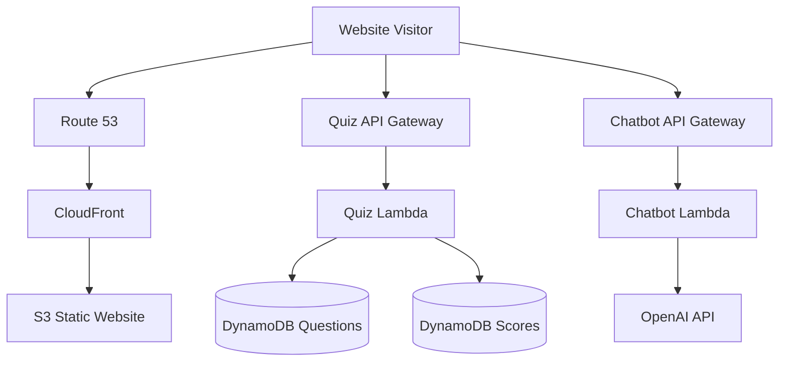

# AWS Portfolio Website — Deployment Guide

## Overview

This project is a serverless portfolio website hosted on AWS. It combines a static frontend with two independent backend services: an interactive quiz application and an AI-powered chatbot.

The infrastructure uses managed AWS services to provide global content delivery, DNS management, serverless compute, and persistent data storage.

## Architecture

### AWS Services

| Service                       | Purpose                                                 |
| ----------------------------- | ------------------------------------------------------- |
| Amazon S3                     | Stores the static website files                         |
| Amazon CloudFront             | Delivers website content globally over HTTPS            |
| Amazon Route 53               | Manages DNS records for the custom domain               |
| AWS Certificate Manager (ACM) | Provides the SSL/TLS certificate for HTTPS              |
| Amazon API Gateway            | Exposes HTTP endpoints for backend functionality        |
| AWS Lambda                    | Executes quiz and chatbot backend logic                 |
| Amazon DynamoDB               | Stores quiz questions and submitted scores              |
| OpenAI API                    | Generates chatbot responses                             |
| Amazon CloudWatch             | Collects Lambda logs for monitoring and troubleshooting |
| AWS IAM                       | Controls permissions between AWS services               |

### High-Level Architecture

The website and backend APIs are separate request paths. CloudFront delivers the static frontend, while the browser sends API requests directly to API Gateway.

## 1. DNS and Domain Configuration

**Service:** Amazon Route 53

Route 53 maps the custom domain to the CloudFront distribution.

The production configuration includes:

- An A record alias pointing to the CloudFront distribution.
- An AAAA record alias for IPv6 support.
- NS and SOA records for the hosted zone.
- A certificate validation record used by AWS Certificate Manager.

### Deployment Steps

1. Register a domain or use an existing domain.
2. Create a Route 53 public hosted zone if DNS is managed through Route 53.
3. Request an SSL/TLS certificate through AWS Certificate Manager in your region for a CloudFront distribution.
4. Validate the certificate using the required DNS record.
5. Configure A and, if needed, AAAA alias records pointing to CloudFront.

For a custom domain, ensure the domain's authoritative nameservers point to the correct hosted zone.

## 2. Static Frontend — S3 and CloudFront

**Services:** Amazon S3, Amazon CloudFront, AWS Certificate Manager

The frontend consists of HTML, CSS, JavaScript, and static assets. Amazon S3 stores these files, and CloudFront distributes them to website visitors.

### Configuration

| Setting                  | Configuration                                   |
| ------------------------ | ----------------------------------------------- |
| S3 bucket                | A bucket dedicated to the website               |
| Default document         | `index.html`                                    |
| Error document           | `error.html`, if configured                     |
| CloudFront origin        | S3 website endpoint in the current architecture |
| Viewer protocol          | Redirect HTTP to HTTPS                          |
| Allowed frontend methods | GET and HEAD                                    |
| Compression              | Enabled                                         |
| HTTP version             | HTTP/2                                          |
| IPv6                     | Enabled                                         |
| TLS certificate          | ACM certificate in `us-east-1`                  |

### Deployment Steps

1. Create an S3 bucket for the website files.
2. Upload the HTML, CSS, JavaScript, and asset files while preserving the directory structure.
3. Configure static website hosting and the appropriate index and error documents.
4. Create a CloudFront distribution with the S3 website endpoint as its origin.
5. Configure HTTPS, the default root object, and the custom domain.
6. Attach the validated ACM certificate.
7. Configure Route 53 to point the domain to the distribution.
8. Invalidate CloudFront's cache after deployments when immediate updates are required.

### Security Considerations

The current architecture uses an S3 static website endpoint as the CloudFront origin. Website endpoints use HTTP between CloudFront and S3 and generally require the website content to be publicly readable.

For a more restrictive production deployment, consider switching to an S3 REST endpoint with CloudFront Origin Access Control (OAC). This allows the bucket to remain private while CloudFront serves the site. S3 website hosting features such as its native error-document handling and website redirects would need to be handled differently.

## 3. Quiz Backend — API Gateway, Lambda, and DynamoDB

**Services:** Amazon API Gateway, AWS Lambda, Amazon DynamoDB

The quiz backend retrieves questions, accepts submitted scores, and calculates the average score across attempts.

### API Routes

| Method  | Route             | Purpose                                       |
| ------- | ----------------- | --------------------------------------------- |
| GET     | `/quiz/questions` | Retrieves a randomized selection of questions |
| POST    | `/quiz/submit`    | Validates and stores a score                  |
| GET     | `/quiz/average`   | Returns the average score and total attempts  |
| OPTIONS | Applicable routes | Supports browser CORS preflight requests      |

The routes are integrated with a dedicated Lambda function through an API Gateway HTTP API.

### DynamoDB Tables

#### Questions Table

| Attribute       | Type   | Purpose                               |
| --------------- | ------ | ------------------------------------- |
| `questionID`    | String | Partition key and question identifier |
| `question`      | String | Question text                         |
| `options`       | List   | Available answer choices              |
| `correctAnswer` | Number | Index of the correct answer           |

#### Scores Table

| Attribute        | Type   | Purpose                                   |
| ---------------- | ------ | ----------------------------------------- |
| `scoreID`        | String | Partition key and unique score identifier |
| `timestamp`      | Number | Sort key and submission timestamp         |
| `score`          | Number | Submitted score                           |
| `totalQuestions` | Number | Number of questions in the attempt        |

Both tables use on-demand (`PAY_PER_REQUEST`) billing in the reference deployment.

### Lambda Configuration

The quiz Lambda uses a supported Node.js runtime and the AWS SDK for JavaScript v3.

Its execution role requires only the DynamoDB permissions needed for its operations:

- `dynamodb:Scan` on the questions table.
- `dynamodb:PutItem` on the scores table.
- `dynamodb:Scan` on the scores table.

Restrict permissions to the required table resources.

### Deployment Steps

1. Create the questions and scores tables with the appropriate key schemas.
2. Populate the questions table with quiz questions.
3. Create the Lambda function and deploy the backend code.
4. Configure its runtime, handler, and execution role.
5. Create an API Gateway HTTP API.
6. Add the quiz routes and integrate them with Lambda.
7. Configure CORS to permit requests from the deployed frontend.
8. Deploy the API stage and configure the frontend with the API endpoint.
9. Test question retrieval, score submission, and average-score retrieval.

**Important:** The browser must not be trusted to calculate a legitimate score. A production version should validate submitted answers and calculate the final score on the backend rather than accepting an arbitrary client-provided value.

## 4. Chatbot Backend — API Gateway, Lambda, and OpenAI

**Services:** Amazon API Gateway, AWS Lambda, OpenAI API

The chatbot allows visitors to ask questions through the portfolio interface. API Gateway forwards requests to Lambda, which sends the visitor's message to OpenAI and returns the generated response.

### API Routes

| Method  | Route   | Purpose                                 |
| ------- | ------- | --------------------------------------- |
| POST    | `/chat` | Sends a message to the chatbot          |
| OPTIONS | `/chat` | Handles browser CORS preflight requests |

### Lambda Configuration

The chatbot Lambda uses a supported Node.js runtime and a longer timeout than the quiz function to accommodate external AI API latency.

Its configuration includes:

- An appropriate execution timeout.
- The `OPENAI_API_KEY` environment variable.
- Optional model and system-prompt configuration.
- CORS settings consistent with API Gateway.
- CloudWatch logging for troubleshooting.

### Security

The OpenAI API key must remain on the server side. Never place it in frontend JavaScript, HTML, a public configuration file, or a GitHub commit.

For production, consider storing the key in AWS Secrets Manager or another appropriate secret-management solution. Restrict API access and monitor usage to reduce the risk of unexpected costs.

### Deployment Steps

1. Create the chatbot Lambda function.
2. Configure its runtime, handler, execution role, and environment variables.
3. Create an API Gateway HTTP API.
4. Add the POST and OPTIONS routes.
5. Integrate the routes with Lambda.
6. Configure CORS for the deployed frontend origin.
7. Deploy the API stage.
8. Update the frontend to use the API endpoint.
9. Test successful requests, malformed input, and upstream API errors.

If API Gateway automatic deployment is disabled, publish changes to the appropriate stage after modifying routes or integrations.

## 5. Environment-Specific Configuration

Use environment variables and deployment configuration rather than hardcoding personal or account-specific details.

| Variable                | Used by        | Purpose                                |
| ----------------------- | -------------- | -------------------------------------- |
| `AWS_REGION`            | Quiz Lambda    | Region containing the DynamoDB tables  |
| `QUESTIONS_TABLE`       | Quiz Lambda    | Questions table name                   |
| `SCORES_TABLE`          | Quiz Lambda    | Scores table name                      |
| `ALLOWED_ORIGIN`        | Both Lambdas   | Permitted frontend origin for CORS     |
| `OPENAI_API_KEY`        | Chatbot Lambda | OpenAI authentication credential       |
| `OPENAI_MODEL`          | Chatbot Lambda | Optional model selection               |
| `CHATBOT_SYSTEM_PROMPT` | Chatbot Lambda | Optional chatbot behavior instructions |

Configure these values in the AWS console or deployment pipeline. Do not commit actual secrets to the repository.

## 6. Deployment and Verification Checklist

### Initial Deployment

- [ ] Create the S3 bucket and upload the frontend.
- [ ] Configure CloudFront and HTTPS.
- [ ] Configure Route 53 DNS records.
- [ ] Create and populate the DynamoDB tables.
- [ ] Deploy the quiz Lambda and configure IAM permissions.
- [ ] Deploy the chatbot Lambda and configure its API credential.
- [ ] Create API Gateway routes and integrations.
- [ ] Configure CORS for the correct website origin.
- [ ] Update frontend API endpoint configuration.
- [ ] Test both backend features in the deployed website.

### After Code Changes

- [ ] Deploy the updated Lambda package.
- [ ] Confirm API Gateway routes and integrations are correct.
- [ ] Publish API changes if automatic deployment is disabled.
- [ ] Upload updated frontend assets to S3.
- [ ] Invalidate CloudFront cache if needed.
- [ ] Review CloudWatch logs for errors.
- [ ] Confirm no credentials or private configuration were committed.

## 7. Monitoring and Cost Management

The system uses managed and serverless services, reducing the need to maintain dedicated servers.

Important considerations include:

- **CloudFront:** Monitor data transfer, requests, and cache behavior.
- **Lambda:** Review invocation counts, duration, errors, and throttling.
- **API Gateway:** Monitor request volume and error rates.
- **DynamoDB:** Monitor read/write activity and table growth.
- **OpenAI:** Monitor API usage and set appropriate spending limits where available.
- **CloudWatch:** Avoid logging API keys, sensitive visitor information, or complete request bodies unnecessarily.

On-demand DynamoDB billing is useful for workloads with unpredictable traffic, but scans and frequent requests can still generate costs.

## 8. Architecture Improvements

Potential improvements for future iterations include:

1. Use a private S3 bucket with CloudFront OAC.
2. Validate quiz answers and calculate scores server-side.
3. Add API throttling and abuse protection.
4. Store AI credentials in a dedicated secret-management service.
5. Introduce automated deployment through infrastructure as code.
6. Add automated tests for API routes and backend logic.
7. Use DynamoDB pagination or an aggregation strategy that scales as score records grow.

## Summary

This deployment combines a static website delivery layer with independent serverless backends. CloudFront and S3 serve the frontend, Route 53 manages domain resolution, API Gateway exposes backend routes, Lambda executes application logic, and DynamoDB persists quiz data. The chatbot additionally integrates with the OpenAI API.

The architecture demonstrates core AWS cloud engineering concepts, including serverless design, API integration, database modeling, DNS management, TLS configuration, IAM permissions, and operational monitoring.

